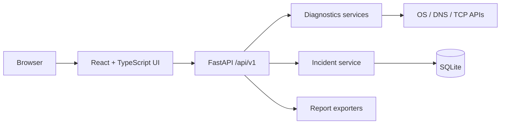

# Architecture

Diagnostics are isolated from HTTP and storage. System-dependent calls can be mocked. The API validates requests and returns stable error envelopes. React never invokes OS commands.
